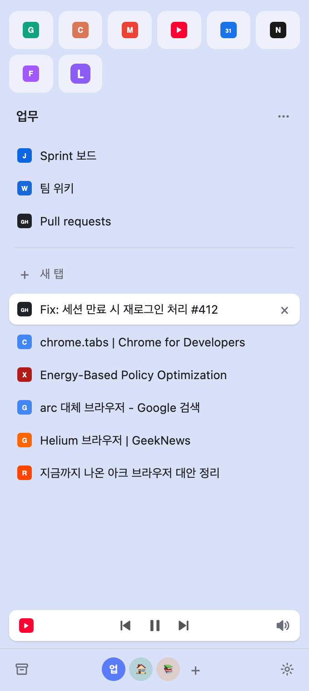
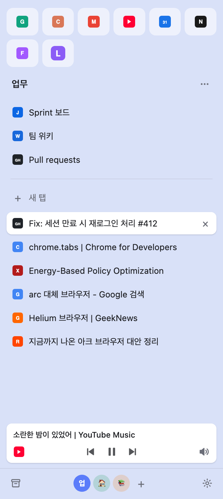
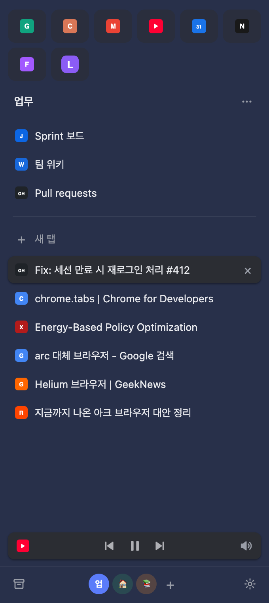

# Arc Space

Arc 대신 쓰는 크롬 확장입니다. 크롬 사이드패널에 Arc처럼 세로 탭 목록과 스페이스 전환을 띄우고, 24시간 동안 안 본 탭을 자동으로 정리합니다.

<p>
  
  
  
</p>

기능별 설명과 화면은 **[기능 안내 문서(docs/index.html)](docs/index.html)** 에 있습니다.

## 설치

Chrome 121 이상이 필요합니다. 분할 화면은 Chrome 155, `⌘B`로 사이드패널 닫기는 Chrome 141 이상에서 동작합니다.

1. 저장소를 내려받습니다.
   ```sh
   git clone https://github.com/Eun0/Chrome_Extension_Arc_Space.git
   ```
   git을 쓰지 않는다면 GitHub의 **Code → Download ZIP**으로 받아 압축을 풉니다.
2. 크롬에서 `chrome://extensions`를 열고 오른쪽 위 **개발자 모드**를 켭니다.
3. **압축해제된 확장 프로그램을 로드합니다**를 누르고 내려받은 폴더를 고릅니다.
4. 툴바의 Arc Space 아이콘을 누르거나 `⌘B`(Windows는 `Ctrl+B`)로 사이드패널을 엽니다.
5. (선택) Arc처럼 왼쪽에 두려면 `chrome://settings/appearance`에서 **사이드 패널 → 왼쪽에 표시**를 고릅니다.
6. (선택) 단축키가 비어 있거나 바꾸고 싶으면 `chrome://extensions/shortcuts`에서 지정합니다.

업데이트할 때는 `git pull` 후 `chrome://extensions`에서 Arc Space의 새로고침 버튼을 누르고 사이드패널을 다시 엽니다.

## 주요 기능

- **스페이스**: 창 하나에서 업무·개인처럼 탭 묶음을 전환합니다. 하단 아이콘 클릭, 가로 스크롤(MX Master 사이드 휠, 트랙패드 스와이프), `⌥⇧←/→`로 넘깁니다. 전환할 때 바로 볼 탭만 로드하고 나머지는 클릭할 때 로드합니다.
- **공통 즐겨찾기**: 맨 위 아이콘 그리드. 모든 스페이스에서 보이고, 탭을 닫아도 남습니다.
- **스페이스 고정**: 스페이스 이름과 가로선 사이. 그 스페이스 전용이며 자동 정리되지 않습니다.
- **자동 정리**: 가로선 아래 일반 탭 중 24시간(설정 가능) 동안 안 본 탭을 아카이브로 옮깁니다. 아카이브에서 검색하고 다시 열 수 있습니다.
- **드래그**: 탭을 끌어서 즐겨찾기·고정 추가, 다른 스페이스로 이동, 고정 해제를 합니다.
- **분할 화면**: 탭을 다른 탭 가운데에 놓으면 크롬 Split View로 나란히 봅니다.
- **미니 플레이어**: 음악 탭을 보고 있지 않을 때 하단에 재생바가 생기고, 마우스를 올리면 제목이 펼쳐집니다.
- **아이콘 꾸미기**: 즐겨찾기 아이콘을 색 블록, 이모지, 이미지로 바꿉니다.

## 한계

- 크롬 위쪽 가로 탭 바는 확장으로 숨길 수 없습니다.
- 사이드패널 최소 폭은 크롬이 정해서 더 좁게 줄일 수 없습니다.
- 스페이스를 바꾸면 탭을 새로 열기 때문에 스크롤 위치와 입력 중인 내용은 유지되지 않습니다.
- 창 하나 기준입니다. 창이 여러 개면 스페이스 전환은 사이드패널이 열린 창에만 적용됩니다.

## 파일 구성

| 파일 | 역할 |
|---|---|
| `manifest.json` | 확장 설정 (MV3) |
| `background.js` | 스페이스 전환, 즐겨찾기, 자동 정리, 단축키 (service worker) |
| `sidepanel.{html,css,js}` | 사이드패널 UI |
| `media-hook.js` | 재생바용 Media Session 훅 (허용한 사이트에만 주입) |
| `docs/` | 기능 안내 문서와 스크린샷. `zsh docs/capture/capture.sh`로 스크린샷을 다시 찍습니다 |

데이터는 모두 `chrome.storage`에 로컬로 저장되며 외부로 보내지 않습니다.
